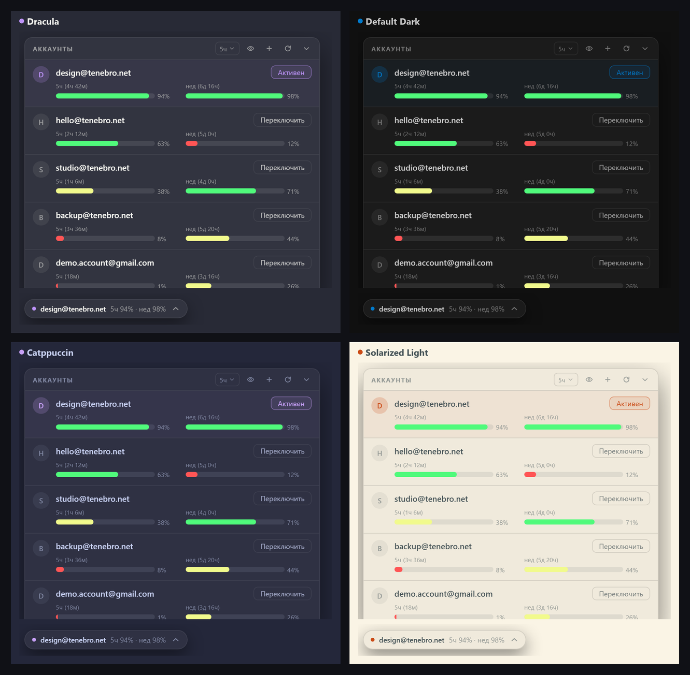

<div align="left">

# Antigravity Auto Switcher

<p>
  
  
  
  
  
</p>

**Маленькая панель-оверлей для Antigravity: все аккаунты, лимиты и переключение в один клик — прямо поверх окна чата.**

Не отдельное громоздкое приложение, а аккуратная плашка в углу Antigravity. Показывает остаток 5-часового и недельного лимита по каждому аккаунту и **сама меняет аккаунт до того, как лимит закончится** — чаты при этом не останавливаются, приложение не перезапускается.

</div>



---

## 📥 Скачать

<p>
  <a href="https://github.com/xRAYNERx/antigravity-auto-switcher/releases/latest">
    
  </a>
</p>

* **`Antigravity Switcher.zip`** — портативная версия. Распаковать в любую папку и запустить `Antigravity Switcher.exe`. Установка не нужна.
* **Требования:** Windows 10/11 x64 и установленный Antigravity. Больше ничего — Node.js и Python не нужны, всё внутри.

> **Windows SmartScreen** может предупредить при первом запуске («Windows protected your PC»). Это нормально для неподписанной программы: «Подробнее» → «Выполнить в любом случае».

---

## Возможности

| | |
|---|---|
| **Автопереключение** | 5-часовой лимит падает до **5%** или недельный до **1%** — панель сама переключает на аккаунт с запасом. Работа не останавливается. |
| **Ручное переключение** | Один клик + подтверждение «Точно?». Сессия меняется за 2–3 секунды, без перезапуска АГ. |
| **Лимиты в реальном времени** | Остаток и время до сброса по каждому аккаунту, полоски с процентами. |
| **Сортировка** | По остатку 5ч, по остатку недели, по времени сброса 5ч и недели. Активный аккаунт всегда сверху. |
| **Скрытие почт** | Кнопка-глазик для скриншотов и видео. |
| **Свёрнутый режим** | Компактная плашка только с текущим аккаунтом. |
| **Темы** | Цвета берутся из темы Antigravity: Dracula, Default Dark, Catppuccin, Solarized Light и любые ваши кастомные. |
| **Лимит картинок** | Когда генерация изображений упирается в квоту, панель показывает точное время восстановления, которое вернул сервер. |
| **Автообновление** | Панель сама проверяет релизы на GitHub, показывает плашку «Вышло обновление» и обновляется в один клик. |

---

## Как это работает

1. Токены аккаунтов лежат в «Хранилище учётных данных Windows» (`gemini:antigravity`) — там же, где их держит сам Antigravity.
2. При переключении панель записывает токен нужного аккаунта.
3. Внутренний сервис Antigravity замечает, что токен изменился снаружи, и меняет сессию в памяти.
4. Интерфейс обновляется, чтобы показать новый аккаунт. Чаты, проекты и история остаются на месте.

Панель рисуется поверх окна через отладочный порт Antigravity (CDP). Файлы приложения не изменяются, поэтому обновления Antigravity её не ломают.

---

## Автопереключение

* Проверка лимитов каждые **30 секунд**.
* Смена срабатывает, когда у активного аккаунта:
  * 5-часовой лимит **≤ 5%**, или
  * недельный лимит **≤ 1%** (независимо от 5-часового).
* Новый аккаунт должен иметь **оба** лимита выше 10%.
* После переключения — пауза 2 минуты, чтобы не было «пинг-понга».
* Если подходящего аккаунта нет, панель показывает предупреждение и никого не трогает.

---

## Лимит генераций изображений

Antigravity не отдаёт точное «сколько картинок осталось» — у Google здесь динамическая квота (Dynamic Shared Quota), фиксированного числа нет. Зато в момент исчерпания сервер возвращает точное время восстановления, и панель показывает его плашкой:

> Картинки: лимит исчерпан · восстановится через 3ч 17м (07:57)

Плашка исчезает сама, когда квота восстанавливается.

---

## Установка

1. Скачать `Antigravity Switcher.zip` из [Releases](https://github.com/xRAYNERx/antigravity-auto-switcher/releases/latest).
2. Распаковать в любую папку (например, `D:\Programs\Antigravity Switcher`).
3. Запустить `Antigravity Switcher.exe`.
4. Открыть Antigravity — панель появится внизу слева, рядом с кнопкой Settings.

При первом запуске создаются ярлыки на рабочем столе и в автозагрузке.

### Добавить аккаунт

1. Войти в нужный аккаунт в самом Antigravity (Настройки → аккаунт).
2. Нажать **«+»** в панели — аккаунт и токен сохранятся.
3. Переключаться одним кликом.

---

## Обновления

Панель раз в 6 часов (и при запуске) проверяет последний релиз на GitHub. Если версия новее:

* панель раскрывается и показывает сверху плашку «Вышло обновление X.Y.Z»;
* по кнопке «Обновить» скачивает архив, заменяет файлы и перезапускается сама.

---

## Сборка из исходников

Нужны Node.js (из него берётся `node.exe` для архива) и .NET Framework (`csc.exe` для лаунчера).

```powershell
powershell -ExecutionPolicy Bypass -File build\build.ps1
```

На выходе:

* `dist\Antigravity Switcher\` — готовая папка;
* `Antigravity Switcher.zip` — архив для релиза.

---

## Структура проекта

| Путь | Назначение |
|---|---|
| `agpanel.js` | фоновый процесс: CDP-подключение, оверлей, квоты, переключение, автообновление |
| `ui.js` | интерфейс панели (встраивается в страницу Antigravity) |
| `cred.ps1` | чтение/запись токена через Windows Credential Manager |
| `version.json` | текущая версия |
| `start_panel.vbs` / `stop_panel.vbs` | запуск и остановка из исходников |
| `build/launcher.cs` | C#-лаунчер (`Antigravity Switcher.exe`) |
| `build/build.ps1` | сборка релиза |
| `docs/` | скриншоты и генератор коллажа |

---

## Ограничения

* Лимиты считаются онлайн, через Google. Если сеть недоступна, показываются последние сохранённые значения, а автопереключение ждёт свежих данных.
* Если аккаунт очень долго не использовался, Google может отозвать refresh-токен — тогда его нужно один раз перелогинить вручную и снова нажать «+».
* При первом входе в аккаунт Antigravity показывает окно «Security Notice & Data Use». Панель подтверждает его автоматически (один раз на аккаунт), иначе переключение не завершится.

---

## Лицензия

[MIT](LICENSE). Внутри распространяется Node.js — его лицензия в [THIRD_PARTY_NOTICES.md](THIRD_PARTY_NOTICES.md).

Проект не связан с Google. «Antigravity» и «Gemini» — товарные знаки Google LLC.
